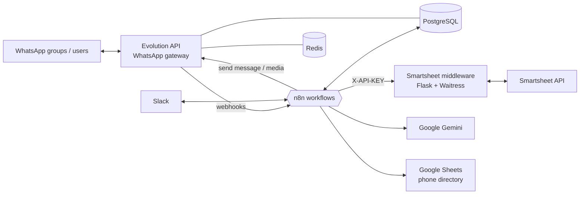

# n8n AI Automations

[](https://github.com/H-rasool/ai-automations/actions/workflows/ci.yml)


Self-hosted [n8n](https://n8n.io) automations that connect **WhatsApp**, **Slack** and **Smartsheet**, with an
**AI end-of-day summarizer** (Google Gemini) and a **WhatsApp assistant for project tracking**. The whole stack
runs from a single `docker compose up`.

> The workflows were built for a real engineering team's day-to-day coordination. This repository is a
> cleaned, anonymised version: all client names, IDs, phone numbers and credentials have been removed or replaced
> by placeholders and environment variables.

## What it does

| Automation | Description |
|---|---|
| **WhatsApp ⇄ Slack bridge** | Two-way relay between WhatsApp groups and Slack channels, including images, video, audio and documents. De-duplicates messages and ignores bot echoes and reactions. |
| **AI end-of-day summary** | Messages from a chosen group are logged all day; every morning Gemini turns the transcript into a structured summary (TL;DR, test results, faults, discussions, action items) and posts it back to WhatsApp. |
| **Smartsheet task tracking** | Keeps a Postgres mirror of one or more Smartsheet project plans in sync, sends each team member a personalised morning/evening WhatsApp digest (overdue, due soon, projected slippage), and lets people report progress by replying `Tid0042 80%` on WhatsApp, which writes back to Smartsheet. |
| **WhatsApp admin assistant** | A manager can message the bot an employee's name and get an instant audit (completion rate, active/pending/completed tasks, last feedback) built from the synced data. |
| **Critical-path calculator** *(experimental)* | Computes the critical path of a task plan (FS/SS/FF/SF dependencies, lags, working days) and flags changed rows. |

## Architecture



Everything inside the box runs in Docker on one private network. Only n8n needs to be reachable from the
internet (for Slack and WhatsApp webhooks); an optional Cloudflare tunnel service is included for that.
More diagrams (message flows, update sequence) are in [`docs/architecture.md`](docs/architecture.md).

## Tech stack

n8n · Evolution API (WhatsApp) · Slack API · Smartsheet API · Google Gemini · Google Sheets ·
PostgreSQL · Redis · Python (Flask, Waitress) · JavaScript (n8n Code nodes) · Docker Compose · GitHub Actions

## Repository layout

```
.
├── docker-compose.yml          # full stack: n8n, Evolution API, Postgres, Redis, middleware (+ optional pgAdmin, tunnel)
├── .env.example                # every setting, with placeholders
├── n8n/Dockerfile              # n8n with a pinned version
├── middleware/                 # Smartsheet gateway (Flask) + unit tests
├── database/schema.sql         # automation tables, loaded on first start
├── workflows/
│   ├── whatsapp-slack-bridge/  # whatsapp-to-slack, slack-to-whatsapp, eod-summarizer
│   ├── smartsheet-task-tracking/
│   │   ├── project-a/          # smartsheet-sync, task-reminders, admin-assistant
│   │   └── project-b/          # same pipeline for a second sheet
│   └── experimental/           # critical-path
├── docs/                       # setup, architecture, workflow reference
├── scripts/validate_repo.py    # workflow validation + secret/PII scanner (also run in CI)
└── .github/workflows/ci.yml
```

## Quick start

Requirements: Docker with Compose v2.

```bash
git clone https://github.com/H-rasool/ai-automations.git
cd ai-automations

cp .env.example .env
# edit .env: set every CHANGE_ME (use `openssl rand -hex 32`), your Smartsheet token and sheet IDs

docker compose up -d --build
```

Then open **http://localhost:5678**, create the n8n owner account, and follow
[`docs/setup.md`](docs/setup.md) to install the WhatsApp community node, create the credentials, import the
workflows from `workflows/`, connect a WhatsApp number and activate everything.

Useful extras:

```bash
docker compose --profile tools up -d    # + pgAdmin on http://localhost:5050
docker compose --profile tunnel up -d   # + Cloudflare quick tunnel for public webhooks
```

## Configuration

All settings live in `.env` (see [`.env.example`](.env.example)). The most important ones:

| Variable | Purpose |
|---|---|
| `N8N_ENCRYPTION_KEY` | Encrypts credentials stored in n8n. Back it up; do not change it later. |
| `EVOLUTION_API_KEY` | API key of the WhatsApp gateway. |
| `MIDDLEWARE_API_KEY` | Shared secret n8n sends (`X-API-KEY`) to the Smartsheet middleware. |
| `SMARTSHEET_TOKEN` | Smartsheet API token. Only the middleware container sees it. |
| `SHEET_ID_PROJECT_A` / `_B` | Numeric Smartsheet sheet IDs; the workflows read them with `{{ $env.… }}`. |
| `ADMIN_WHATSAPP_JID` | The only WhatsApp number allowed to query the admin assistant. |
| `EXTERNAL_BASE_URL` | Public URL of n8n, used for webhooks. |
| `GENERIC_TIMEZONE` | Timezone of the scheduled workflows. |

The workflows themselves contain **no secrets**: they reference n8n credentials by name and read
everything else from environment variables.

## Smartsheet middleware

`middleware/middleware.py` is a small API between n8n and Smartsheet. It keeps the Smartsheet token out of n8n,
translates column IDs to column titles, and serves any number of sheets by `sheetId`:

| Endpoint | Purpose |
|---|---|
| `GET /api/v1/extract-sheet?sheetId=…` | All rows keyed by column title, with `rowId`, `rowNumber`, `parentId` metadata |
| `POST /api/v1/update-row` | Update cells of one row |
| `POST /api/v1/update-batch` | Update up to 500 rows in one call |
| `GET /health` | Liveness probe (no auth) |

Requests need the `X-API-KEY` header; the check is constant-time and **fails closed** if no key is configured.

```bash
cd middleware
pip install -r requirements-dev.txt
pytest
```

## Security notes

- No credentials or personal data are committed; `.env`, data volumes and exports are git-ignored.
- Imported workflows are **inactive** until you activate them, and credentials are placeholders you map to your own.
- Published ports are bound to `127.0.0.1`; the public tunnel is opt-in (`--profile tunnel`).
- `N8N_BLOCK_ENV_ACCESS_IN_NODE=false` lets workflows read `$env.*` (needed for the sheet IDs and API key). Only run workflows you trust.
- `python scripts/validate_repo.py` checks every workflow and scans the repo for tokens, private keys, phone numbers and real-looking WhatsApp/Slack IDs. It runs in CI on every push.
- See [`SECURITY.md`](SECURITY.md).

## Known limitations and roadmap

Honest list of what I would improve next:

- [ ] **Parameterise SQL.** Several Postgres nodes build SQL by string interpolation (user text from WhatsApp, Smartsheet fields). Move to n8n's `queryReplacement` parameters to remove injection and quoting risks (the Project B sync does not escape apostrophes).
- [ ] **Safer sync.** The Smartsheet sync truncates the table *before* fetching; a failed fetch leaves an empty table. Fetch first, then upsert and delete stale rows.
- [ ] **Bounded de-duplication.** The WhatsApp de-dup cache lives in workflow static data and grows forever; add TTL cleanup or move it to Redis.
- [ ] **One workflow per pipeline.** Project A and B are copies that differ only in sheet ID and table names; fold them into one parameterised workflow.
- [ ] **Externalise mappings.** WhatsApp-group ⇄ Slack-channel maps live in Code nodes; move them to a database table.
- [ ] **Tidy expressions.** A few expressions use a doubled `==` prefix, which makes n8n prepend a literal `=` (the EOD query matches this on purpose; the summary message shows it).
- [ ] **Finish the critical-path workflow.** It predates the multi-sheet middleware: it still reads a legacy table and does not send `sheetId` to `update-batch`.

## Documentation

- [`docs/setup.md`](docs/setup.md): step-by-step installation and WhatsApp/Slack/Google configuration
- [`docs/architecture.md`](docs/architecture.md): system diagram and message flows
- [`docs/workflows.md`](docs/workflows.md): reference for every workflow (triggers, nodes, tables, inputs)

## License

[MIT](LICENSE) © 2026 H-rasool
