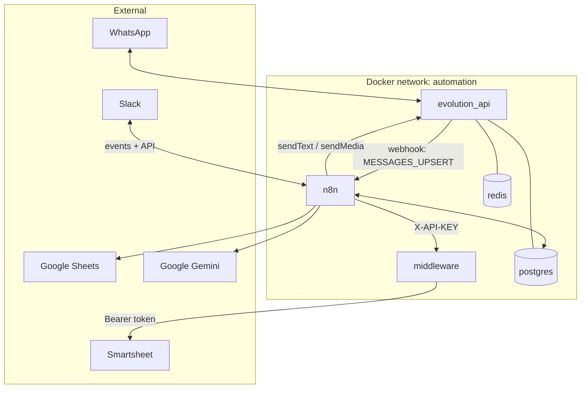
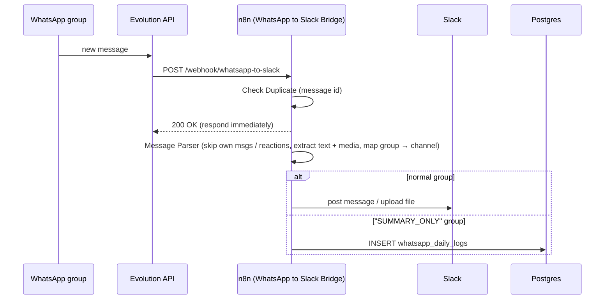
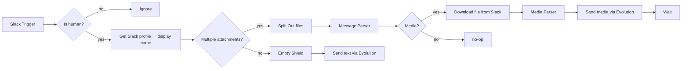
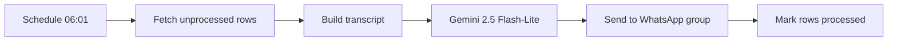
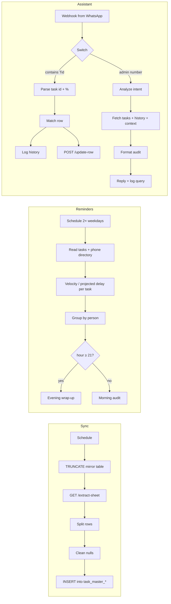
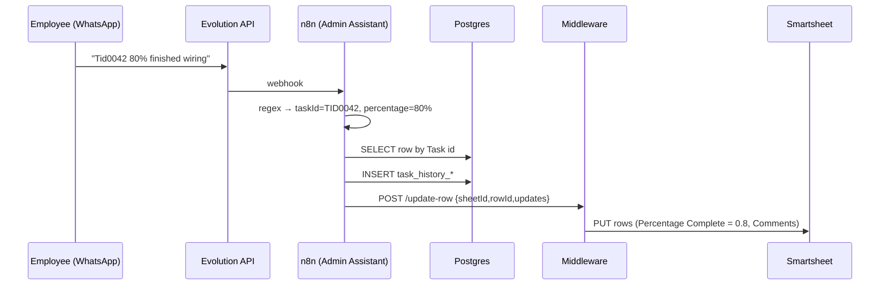

# Architecture

## Components

| Service | Image / source | Role |
|---|---|---|
| `n8n` | `n8n/Dockerfile` (n8n 2.6.3) | Runs all workflows; stores its own data in Postgres |
| `evolution_api` | `evoapicloud/evolution-api` | Self-hosted WhatsApp gateway (HTTP API + webhooks) |
| `middleware` | `middleware/` (Flask + Waitress) | Smartsheet gateway; the only holder of the Smartsheet token |
| `postgres` | `postgres:15-alpine` | n8n DB, Evolution API DB and the automation tables (`database/schema.sql`) |
| `redis` | `redis:7-alpine` | Evolution API cache |
| `pgadmin` *(profile `tools`)* | `dpage/pgadmin4` | Optional DB UI |
| `tunnel` *(profile `tunnel`)* | `cloudflare/cloudflared` | Optional public URL for Slack/WhatsApp webhooks |

All services share one Docker network (`automation`). Workflows address them by service name:
`http://middleware:5001`, `http://evolution_api:8080`, host `postgres`. Host ports are published on
`127.0.0.1` only.

## System context

## WhatsApp → Slack

## Slack → WhatsApp

## End-of-day summary

## Smartsheet task tracking (per project)

### Employee progress update (sequence)

## Design decisions

- **Middleware instead of direct Smartsheet nodes.** Keeps the Smartsheet token out of n8n, lets workflows use column *titles*, and handles any sheet by `sheetId`; one place to add retries or caching later.
- **Postgres mirror of the sheet.** Reminders and the assistant read from Postgres (fast, queryable, no API quota) while Smartsheet stays the source of truth.
- **Respond to the webhook first.** The WhatsApp bridge replies `200` right after de-duplication so the gateway does not retry slow media uploads.
- **Config through environment.** Secrets and IDs are never in the workflow files; they are read from `$env` or n8n credentials, so the same exports work on any instance.
- **Safe-by-default packaging.** Workflows import inactive, ports bind to localhost, and the public tunnel is opt-in.
